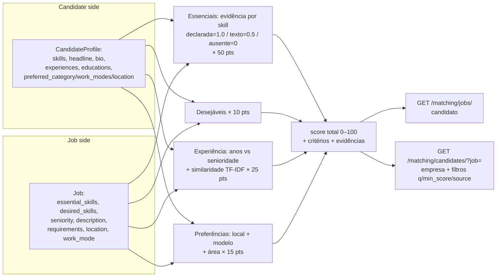

# User Flow Diagrams — Appliety

Aligned with the Figma prototype (pt-BR UI, explainable matching).

## 1. Candidate registration & login

```mermaid
flowchart TD
    A([Visitante]) --> B[/register?role=candidate/]
    B --> C{Escolher perfil:<br/>candidato ou empresa}
    C -->|candidato| D[Etapa 1 — Conta:<br/>nome, e-mail, telefone, cidade,<br/>senha]
    D --> E[Etapa 2 — Perfil:<br/>título, formação, experiência,<br/>área, modelo de trabalho, localização, bio]
    E --> F{Dados válidos?}
    F -->|Não| E
    F -->|Sim| G[POST /api/auth/register/]
    G --> H[User + CandidateProfile criados<br/>token emitido]
    H --> I[/dashboard/]
    I --> J[Completar perfil: habilidades,<br/>experiências, formação, currículo PDF/DOCX]
    J --> K[Buscar /jobs]

    L([Usuário recorrente]) --> M[/login/ e-mail ou usuário + senha]
    M --> N[POST /api/auth/login/]
    N --> O{Credenciais válidas?}
    O -->|Não| M
    O -->|Sim| P[Token salvo → painel do perfil]

    Q([Esqueceu a senha]) --> R[/forgot-password/ e-mail]
    R --> S[POST /api/auth/password/reset/]
    S --> T[E-mail com link /reset-password/?uid&token]
    T --> U[POST /api/auth/password/reset/confirm/]
    U --> M
```

## 2. Company registration

```mermaid
flowchart TD
    A[/register?role=company/] --> B[Etapa 1 — Responsável:<br/>nome, e-mail profissional,<br/>cargo, telefone, senha,<br/>confirmação de autorização + termos]
    B --> C[Etapa 2 — Empresa:<br/>razão social, nome fantasia, CNPJ,<br/>site, setor, tamanho, cidade/UF, descrição]
    C --> D[POST /api/auth/register/]
    D --> E[User + CompanyProfile criados]
    E --> F[/company/dashboard/ painel de vagas]
```

## 3. Company publishes a vacancy (3-step wizard)

```mermaid
flowchart TD
    A[/company/jobs/] --> B[/company/jobs/new/]
    B --> C[Etapa 1 — Dados e descrição:<br/>título, área, local, modelo, tipo,<br/>senioridade, contrato, salário,<br/>descrição, responsabilidades]
    C --> D[Etapa 2 — Requisitos e matching:<br/>requisitos + competências<br/>essenciais (50pts) e desejáveis (10pts)]
    D --> E[Etapa 3 — Revisão:<br/>resumo + estado rascunho/publicada/pausada]
    E --> F{Publicar?}
    F -->|Rascunho| G[Salvo como draft]
    F -->|Publicada| H[POST /api/jobs/ status=published]
    H --> I[Visível na busca pública /jobs<br/>e recebe candidaturas]
    G --> J[/company/jobs/:id/edit/ retomar]
```

## 4. Candidate searches & applies

```mermaid
flowchart TD
    A[/jobs/ busca consolidada] --> B[Filtros: título/área, cidade,<br/>competência + ordenação]
    B --> C[Cards de vagas]
    C --> D[/jobs/:id/ detalhes com abas:<br/>visão geral, responsabilidades,<br/>requisitos, como se candidatar]
    D --> E{Logado como candidato?}
    E -->|Não| F[Prompt para registrar/entrar]
    E -->|Sim| G[Sidebar: score de compatibilidade<br/>com breakdown por critério]
    G --> H[Clique em 'Quero me candidatar']
    H --> I[Tela de revisão da candidatura<br/>+ carta de apresentação opcional]
    I --> J[Confirmar e enviar]
    J --> K{Duplicada ou vaga fechada?}
    K -->|Sim| L[Erro 400 exibido]
    K -->|Não| M[Application criada<br/>status = applied]
    M --> N[Tela de confirmação ✓]
    N --> O[/applications/ 'Minhas candidaturas'<br/>com timeline de status]
```

## 5. Matching — explainable weighted criteria



## 6. Application management

```mermaid
flowchart TD
    A[/company/jobs/:id/applications/] --> B[Lista de candidaturas da vaga<br/>filtro por status]
    B --> C[Expandir → carta de apresentação,<br/>e-mail do candidato, histórico]
    C --> D[Alterar status:<br/>em análise / entrevista /<br/>não avançou / contratado]
    D --> E[PATCH /api/applications/:id/]
    E --> F[ApplicationStatusHistory gravado<br/>com ator + timestamp]
    F --> G[Candidato vê novo status<br/>e timeline em /applications]

    H[/company/applications/ consolidado] --> I[Todas as candidaturas<br/>filtros por vaga e status]
    B --> J[GET /company/matching?job=<br/>ranking + 'Analisar currículo'<br/>evidência por critério]
```

## 7. Admin oversight & reports

```mermaid
flowchart TD
    A[/admin/dashboard/] --> B[Visão geral: usuários, vagas,<br/>candidaturas, tendência mensal,<br/>áreas e habilidades mais pedidas]
    A --> C[/admin/users/ perfis e ativação]
    A --> D[/admin/jobs/ gestão de vagas<br/>rascunho/publicada/pausada]
    A --> E[/admin/applications/ pipeline]
    A --> F[/admin/reports/ exportar]
    F --> G{dataset}
    G -->|candidaturas/vagas| H[Excel .xlsx ou PDF]
    G -->|overview| I[Resumo da plataforma<br/>somente admin]
```
