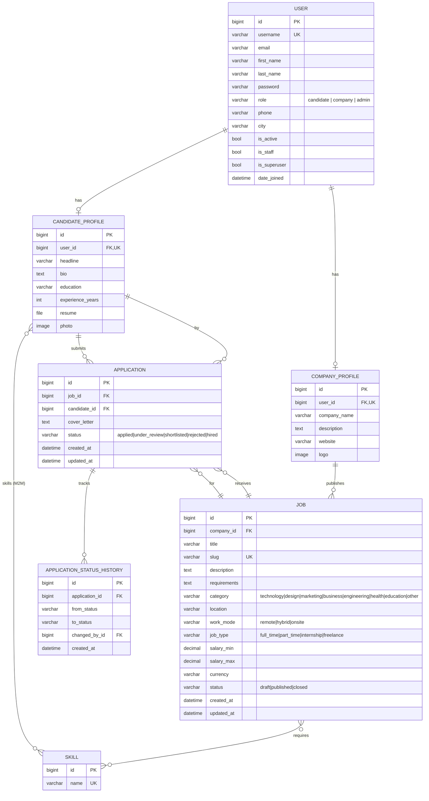

# Database ER Diagram — Appliety

Entities and relationships as implemented in Django models
(`backend/accounts/models.py`, `backend/jobs/models.py`).

## Key constraints & indexes

- `Application(job, candidate)` — **UNIQUE** (no duplicate applications).
- `Job.slug` — unique, auto-generated.
- `User.username`, `User.email`(non-unique), `Skill.name` — unique where noted.
- Indexes: `Job(status, category)`, `Job(location)`, `Job.status`,
  `Application.status`, `User.role`.
- `User` ↔ profiles are `OneToOne`; `User.role` selects which profile is used.
- M2M: `CandidateProfile.skills`, `Job.skills` → `Skill`.
