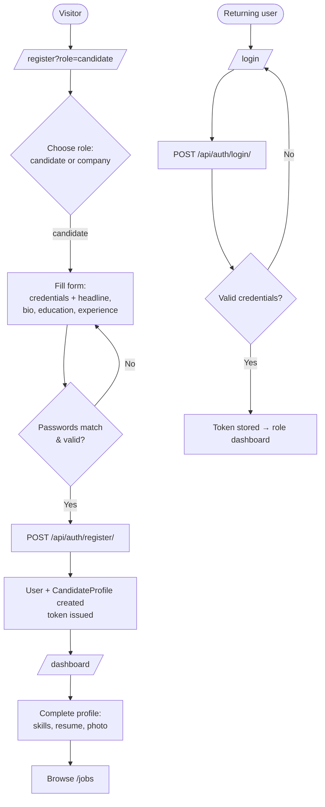
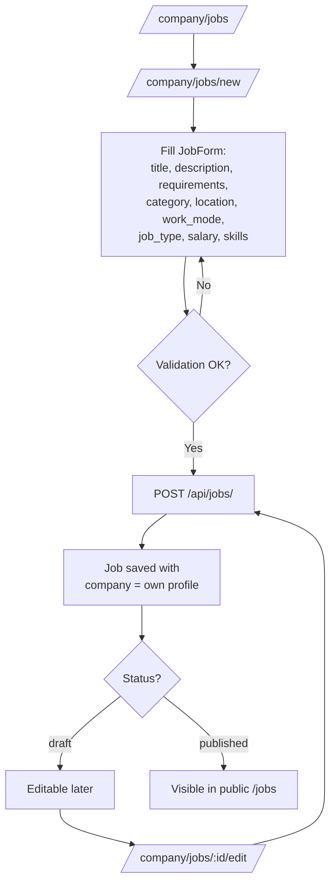
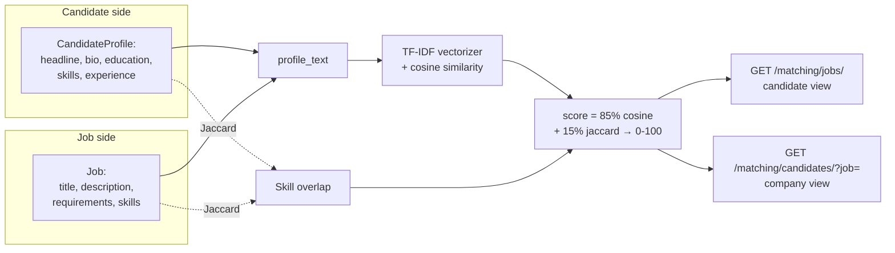
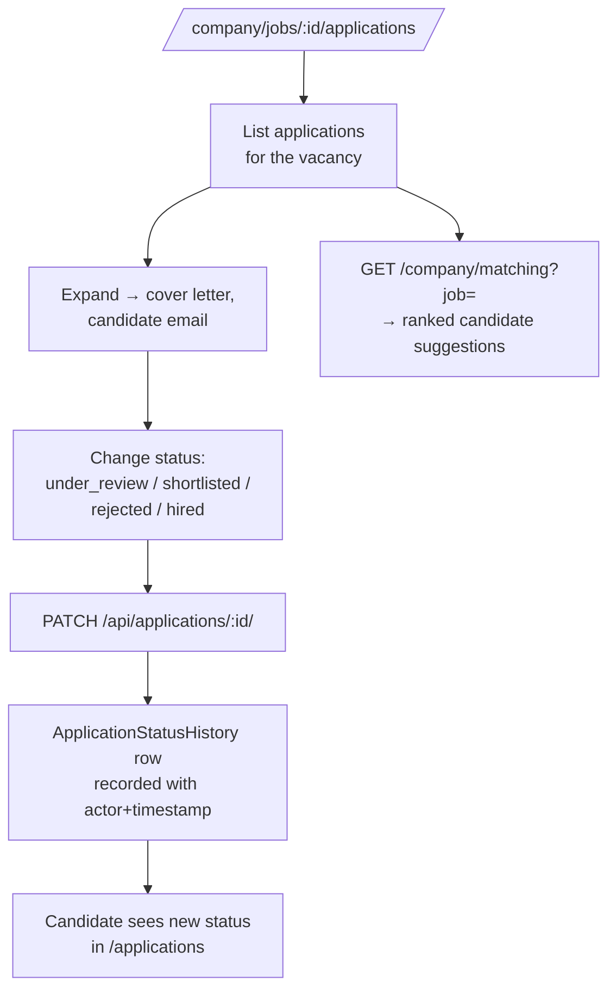

# User Flow Diagrams — Appliety

## 1. Candidate registration & login



## 2. Company registration & login

Same flow as candidate, except `role=company` requires `company_name`;
`CompanyProfile` is created and the user lands on `/company/dashboard`.

## 3. Company creates a vacancy



## 4. Candidate searches & applies

```mermaid
flowchart TD
    A[/jobs/] --> B[Filters: q, category,<br/>location, work_mode]
    B --> C[Job cards list]
    C --> D[/jobs/:id/]
    D --> E{Logged in as<br/>candidate?}
    E -->|No| F[Prompt to register/login]
    E -->|Yes| G[Show compatibility score<br/>+ matched skills]
    G --> H[Optional cover letter]
    H --> I[POST /api/applications/]
    I --> J{Already applied<br/>or job closed?}
    J -->|Yes| K[400 error shown]
    J -->|No| L[Application created<br/>status = applied]
    L --> M[/applications/ track status]
```

## 5. Matching recommendations



## 6. Application management (company)



## 7. Admin oversight & reports

```mermaid
flowchart TD
    A[/admin/dashboard/] --> B[Platform overview:<br/>users, jobs, applications,<br/>monthly trend, top areas/skills]
    A --> C[/admin/users/ manage roles<br/>and activation]
    A --> D[/admin/jobs/ vacancy oversight]
    A --> E[/admin/applications/ pipeline]
    A --> F[/admin/reports/ export]
    F --> G{dataset}
    G -->|applications/jobs| H[Excel .xlsx or PDF<br/>download]
    G -->|overview| I[Admin-only platform<br/>summary export]
```
